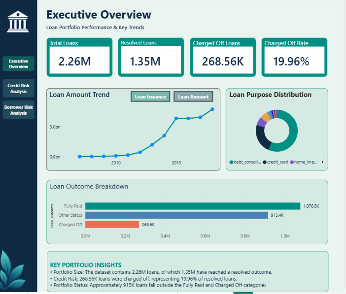
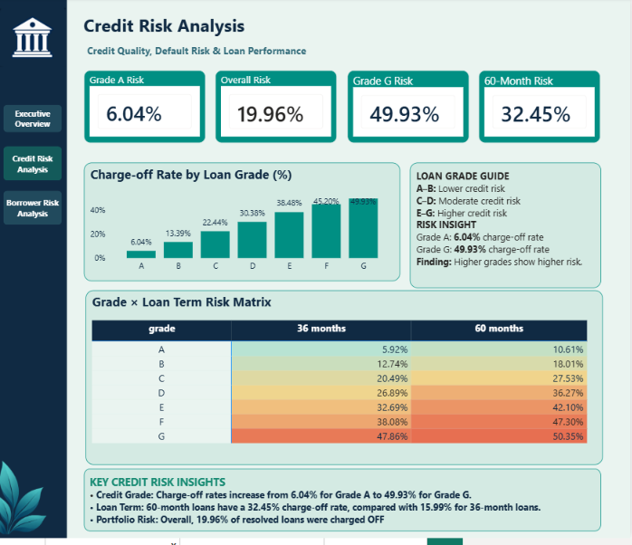
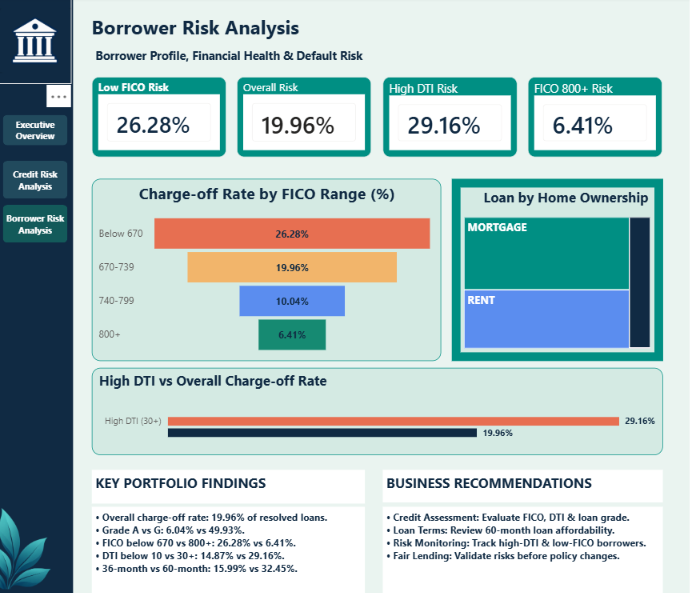

# Loan Default Risk Analysis
**SQL | MySQL | Power BI | DAX**

An analysis of 2.26 million LendingClub loan records to understand loan performance, identify higher-risk borrower segments, and explore the factors associated with charge-offs.

---

## Project Overview

The objective of this project was to analyze historical lending data and understand how loan characteristics and borrower financial profiles relate to repayment outcomes.

I started by validating and cleaning the data in MySQL, followed by exploratory analysis across 12 risk factors. I then created a reporting view and developed a three-page Power BI dashboard to present the findings.

The project focuses on three questions:

- What does the overall loan portfolio look like?
- Which loan characteristics are associated with higher charge-off rates?
- How do borrower attributes such as FICO score and debt-to-income ratio relate to repayment performance?

## Portfolio Summary

| Metric | Value |
|---|---:|
| Total Loans | 2,260,668 |
| Resolved Loans | 1,345,310 |
| Charged-off Loans | 268,559 |
| Charge-off Rate | 19.96% |

**Charge-off Rate = Charged-off Loans / Resolved Loans × 100**

For this analysis, resolved loans include those marked *Fully Paid* or *Charged Off*. Loans with other repayment statuses are excluded from the charge-off rate calculation.

## Tools Used

- **MySQL:** Data validation, cleaning, exploratory analysis, and reporting view creation
- **SQL:** Aggregations, conditional grouping, data quality checks, and KPI calculations
- **Power BI:** Dashboard design, data visualization, and interactive reporting
- **DAX:** Measures, calculated columns, and risk comparisons

## Data Preparation

The original dataset contained 2,260,701 records.

During validation, I identified 33 records with invalid loan IDs (`id = 0`). After inspecting these records and confirming they did not contain meaningful loan information, I removed them.

The final dataset contains **2,260,668 loan records**.

Other data quality observations included:

| Data Quality Check | Finding |
|---|---:|
| Invalid records removed | 33 |
| Zero annual income | 1,671 |
| Zero DTI | 3,443 |
| Negative DTI | 2 |

For reporting, I created cleaned versions of annual income and DTI rather than modifying the original financial values. Nonpositive annual income and negative DTI were converted to NULL in the reporting view, while zero DTI values were retained for separate consideration.

## SQL Analysis

The SQL analysis covers 12 factors:

Loan grade, annual income, DTI, FICO score, interest rate, repayment term, loan purpose, origination year, loan amount, home ownership, employment length, and borrower state.

The analysis uses charge-off rates among resolved loans to compare different borrower and loan segments.

I also created the `vw_loan_dashboard` reporting view with derived fields for issue year, average FICO score, loan outcome, and cleaned financial values. This view was used as the source for the Power BI report.

### SQL Files

| File | Description |
|---|---|
| [01_Data_Cleaning_and_Validation.sql](SQL/01_Data_Cleaning_and_Validation.sql) | Initial data validation, cleaning checks, and data quality findings |
| [02_Loan_Risk_Analysis.sql](SQL/02_Loan_Risk_Analysis.sql) | Charge-off analysis across 12 loan and borrower characteristics |
| [03_Data_Preparation_and_KPIs.sql](SQL/03_Data_Preparation_and_KPIs.sql) | Reporting view, derived columns, cleaned fields, and KPI calculations |

---

## Power BI Dashboard

The dashboard is divided into three pages, each addressing a different part of the analysis.

### 1. Executive Overview



This page provides an overview of the loan portfolio, including total loans, resolved loans, charged-off loans, and overall charge-off rate.

It also includes loan issuance and loan amount trends, loan purpose distribution, and repayment outcome breakdown.

### 2. Credit Risk Analysis



This page focuses on loan grade and repayment term.

The grade comparison chart shows how charge-off rates change from Grade A to Grade G. A grade-by-term matrix helps compare repayment outcomes across both dimensions.

### 3. Borrower Risk Analysis



This page examines borrower-related characteristics, particularly FICO scores and debt-to-income ratios.

It includes FICO-based charge-off rates, home ownership distribution, a high-DTI comparison, and business recommendations.

The dashboard also includes page navigation, interactive visuals, and explanatory KPI tooltips.

---

## Key Findings

### 1. Loan grade shows a clear difference in charge-off rates

Grade A loans have a charge-off rate of **6.04%**, compared with **49.93%** for Grade G loans.

The observed charge-off rate increases across the loan grade categories, suggesting that loan grade is a useful indicator for segmenting portfolio risk.

### 2. Lower FICO scores are associated with higher charge-off rates

Borrowers with FICO scores below 670 have a charge-off rate of **26.28%**, while those with scores of 800 or above have a rate of **6.41%**.

This pattern supports the importance of credit history in borrower risk analysis.

### 3. Higher DTI is associated with weaker repayment outcomes

The charge-off rate increases from **14.87%** for borrowers with DTI below 10 to **29.16%** for borrowers with DTI of 30 or higher.

This suggests that existing debt obligations are an important factor to consider when evaluating repayment capacity.

### 4. Longer-term loans have higher observed charge-off rates

The charge-off rate for 36-month loans is **15.99%**, compared with **32.45%** for 60-month loans.

This difference highlights the importance of examining repayment term alongside other borrower and loan characteristics.

---

## Business Recommendations

Based on the observed patterns, I would recommend:

- **Credit assessment:** Evaluate FICO score, DTI, and loan grade together when reviewing borrower risk.
- **Term analysis:** Review affordability and repayment outcomes for longer-term loans.
- **Risk monitoring:** Track high-DTI and low-FICO segments to identify changes in portfolio performance.
- **Policy validation:** Test these findings further before using them to make lending decisions, including checks for fairness and other relevant factors.

These recommendations are based on historical associations rather than causal analysis.

---

## Repository Structure

```text
Loan-Default-Risk-Analysis/
│
├── README.md
│
├── SQL/
│   ├── 01_Data_Cleaning_and_Validation.sql
│   ├── 02_Loan_Risk_Analysis.sql
│   └── 03_Data_Preparation_and_KPIs.sql
│
├── PowerBI/
│   └── Loan_Default_Risk_Analysis.pbix
│
└── Screenshots/
    ├── 01_Executive_Overview.png
    ├── 02_Credit_Risk_Analysis.png
    └── 03_Borrower_Risk_Analysis.png
```

## How to Explore the Project

The SQL scripts are available in the `SQL` folder and document the analysis from initial validation through reporting preparation.

The dashboard screenshots can be viewed directly in this README.

To explore the interactive report, download [Loan_Default_Risk_Analysis.pbix](PowerBI/Loan_Default_Risk_Analysis.pbix) and open it in Power BI Desktop.

Refreshing the report requires access to a compatible data source.

## Data Source and Limitations

**Data source:** LendingClub historical loan data obtained through Kaggle.

The original dataset is not included in this repository.

A few limitations are important when interpreting the results:

- Charge-off rates are calculated using resolved loans only.
- Recent loan cohorts may have a higher proportion of unresolved loans.
- Some zero financial values may represent missing information from the original import.
- SQL and Power BI FICO groupings use different score representations and may produce different segment-level results.
- The findings describe associations and do not establish causation.

## Conclusion

This project helped me connect SQL-based data preparation with business-focused reporting in Power BI.

The analysis shows how loan grades, credit scores, debt-to-income ratios, and repayment terms can be used to understand differences in historical charge-off performance.

The final dashboard brings these findings together in a format that makes it easier to compare loan segments and identify areas for further investigation.